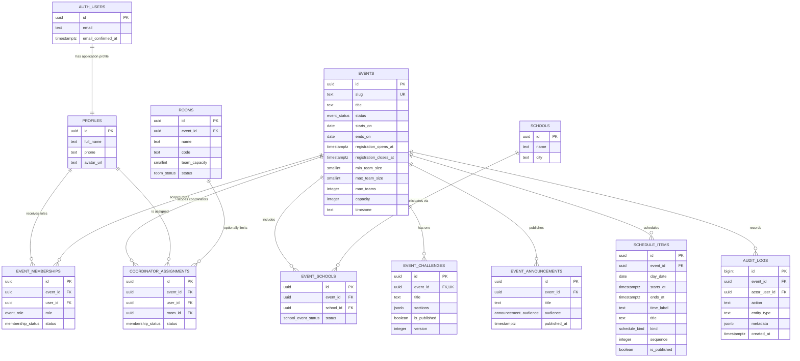
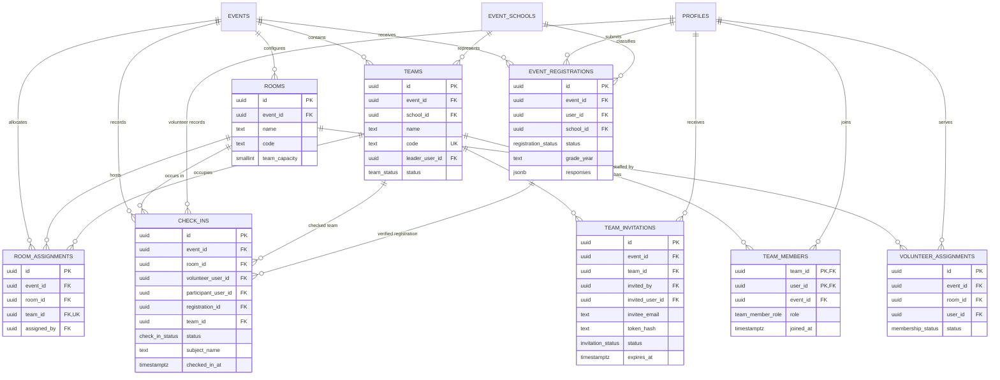

# Gatik Events — Entity Relationship Diagram

**Status:** Design only. No migrations exist.
**Source of truth for:** visual relationships and cardinalities. Column-level detail, constraints, and indexes live in [DATABASE_SCHEMA.md](DATABASE_SCHEMA.md).
**Related:** [RBAC matrix](RBAC_PERMISSION_MATRIX.md) · [Security plan](SECURITY_PLAN.md)

---

## 1. Identity, events, and governance

### Reading the governance diagram

- **One profile per auth user.** Supabase Auth owns credentials; `profiles` owns application identity.
- **Roles are event-scoped rows.** A person can be participant in Xplorer, volunteer in Sports Day, and coordinator in a workshop without changing a global account role.
- **Schools are canonical; participation is event-scoped.** `event_schools` is the bridge that answers "which schools are registered for this event?"
- **A challenge is one per event in the MVP.** Versioning is a column, not a second live challenge.
- **Schedule items hang directly from the event.** No separate `schedules` parent; one event has one schedule.
- **Coordinator scope is explicit.** `room_id = null` means all rooms; a non-null room limits the coordinator.
- **Audit logs may be event-scoped or global.** Role, status, assignment, and check-in changes are written by definer functions/triggers.

---

## 2. Participation, teams, and operations

### Reading the participation diagram

- **Registration precedes team creation.** A user cannot create/join a team without a confirmed `event_registrations` row.
- **One registration and one team membership per event.** Uniqueness is enforced at the database, not just the UI.
- **Team leadership is a membership role,** not an independent boolean. The leader must be a member.
- **Invitations are first-class records.** They are revocable, expiring, single-use, and carry only a token hash.
- **Room allocation is separate from volunteer staffing.** `room_assignments` answers "which team is in this room?"; `volunteer_assignments` answers "who staffs this room?"
- **Check-ins are append-only attempts.** `verified` rows have participant/registration/team; flagged rows may only have a volunteer-entered snapshot.
- **A verified check-in is unique per participant per event.** A partial unique index prevents duplicate attendance.

---

## 3. Cardinality decisions that matter

| Relationship | Cardinality | Why |
|---|---|---|
| User ↔ event memberships | 1:N | A user can hold multiple roles in one event and roles across events. |
| Event ↔ memberships | 1:N | Staff and participants are scoped to the event. |
| Event ↔ schools | M:N via `event_schools` | A school can participate in many events without duplicate institution rows. |
| User ↔ registrations | 1:N across events, 1:1 within event | Unique `(event_id, user_id)`. |
| Team ↔ members | 1:N | 2–5 for Xplorer; `forming` may temporarily have one. |
| User ↔ team memberships | 1:N across events, 1:1 within event | Unique `(event_id, user_id)`. |
| Team ↔ room | 1:1 current allocation | Unique `(team_id)` in `room_assignments`; reassignment updates the row. |
| Room ↔ teams | 1:N, capacity-bounded | Default 2; enforced by assignment RPC. |
| Room ↔ active volunteer | 1:1 default | Partial unique index; configurable by migration. |
| Coordinator ↔ rooms | 1:N, or all | Null room assignment means all rooms. |
| Participant ↔ verified check-in | 1:1 per event | Partial unique index. |
| Event ↔ schedule items | 1:N | Multiple days, ordered by `day_date, sequence`. |
| Event ↔ challenge | 1:1 in MVP | Unique `event_id`; version column for revisions. |

---

## 4. Cross-event isolation

Every operational child row carries `event_id`. Composite foreign keys enforce that a team, room, school, or registration referenced by a child belongs to the same event:

- `team_members(team_id, event_id) → teams(id, event_id)`
- `room_assignments(room_id, event_id) → rooms(id, event_id)`
- `room_assignments(team_id, event_id) → teams(id, event_id)`
- `event_registrations(event_id, school_id) → event_schools(event_id, school_id)`
- `teams(event_id, school_id) → event_schools(event_id, school_id)`

RLS adds the authorization layer on top of this integrity layer. Neither one alone is treated as sufficient.

---

## 5. What is intentionally not in the ERD

- `auth.users` internal columns beyond identity/confirmation.
- Supabase storage objects, sessions, refresh tokens.
- Future tables for notifications, certificates, inventory, analytics, or multi-campus tenancy.
- A separate `participants`, `schedules`, `event_settings`, or `user_preferences` table. See [DATABASE_SCHEMA.md §4](DATABASE_SCHEMA.md#4-deliberately-omitted-or-merged-entities) for the reasoning.

---

## 6. Diagram maintenance

If a migration changes a relationship, update this file in the same pull request. The Mermaid diagrams are explanatory, not generated; do not let them drift from the schema. Column-level changes belong in `DATABASE_SCHEMA.md`.
