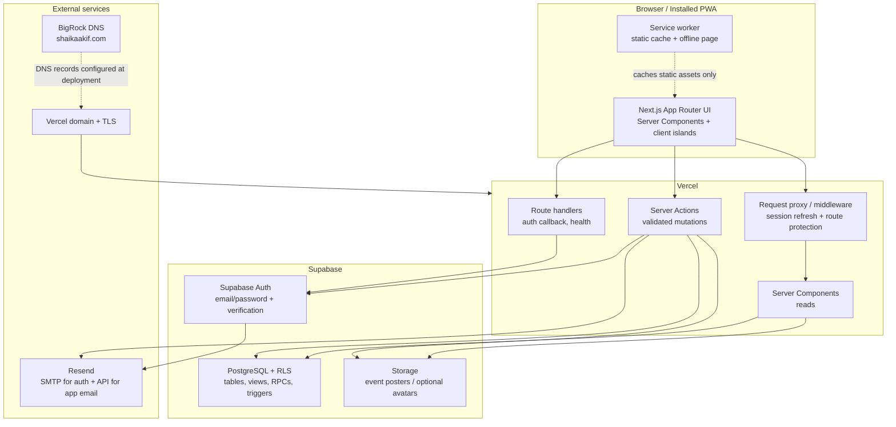
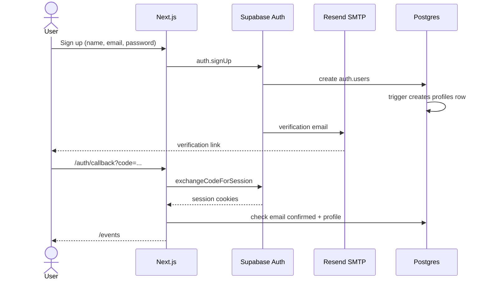
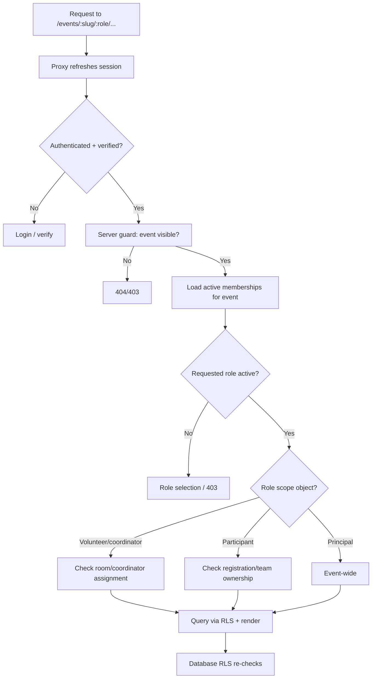
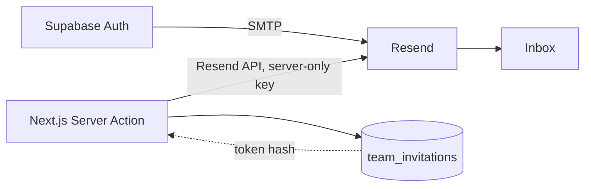

# Historical System Architecture

> **HISTORICAL:** Superseded by the custom-auth architecture in `GATIK_EVENTS_MASTER_PROJECT.md`, `docs/DATABASE_DESIGN.md`, and `docs/SECURITY_REVIEW.md`.

**Status:** Design only. No application has been scaffolded or deployed.
**Source of truth for:** system components, frontend/backend boundaries, auth/authz flow, email, PWA, caching, and deployment procedure.
**Related:** [Product spec](PRODUCT_SPEC.md) · [Database schema](DATABASE_SCHEMA.md) · [Security plan](SECURITY_PLAN.md) · [Implementation roadmap](IMPLEMENTATION_ROADMAP.md)

---

## 1. Architecture at a glance



### Why this shape

- **Next.js on Vercel** keeps reads close to the user, supports server rendering for authenticated pages, and avoids a separate API server.
- **Supabase** provides managed Postgres, Auth, storage, and RLS in one system; RLS is the last line of defense, not the only one.
- **Server Actions** centralize mutations and validation without exposing a public REST surface for the MVP.
- **Resend** is already selected for auth SMTP; reusing it for team invitations avoids a second email vendor.
- **No separate backend service** is justified for an MVP of this size. A dedicated API would add deployment, auth, and validation duplication.
- **PWA is a delivery layer, not an offline database.** Operational offline writes are deliberately excluded.

---

## 2. Technology baseline

No application dependencies are installed yet. Registry versions were checked on **31 October 2026**; these are candidates, to be pinned at M0 after compatibility verification.

| Layer | Candidate | Checked |
|---|---|---|
| Runtime | Node `24.18.1` (installed) | Local |
| Package manager | pnpm `10.18.1` (installed) | Local |
| Framework | Next.js `16.4.3` (registry) | Registry |
| UI runtime | React `19.3.1` (registry) | Registry |
| Styling | Tailwind CSS `4.3.3` (registry) | Registry |
| Supabase client | `@supabase/supabase-js` `2.118.0`, `@supabase/ssr` `0.12.7` | Registry |
| Validation | Zod `4.6.7` | Registry |
| Icons | Lucide React `1.66.0` | Registry |
| PWA | Hand-written service worker (preferred); Serwist `9.5.13` if complexity justifies it | Registry |
| E2E | Playwright `1.64.1` | Registry |
| Unit/integration | Vitest `5.0.5` | Registry |
| Local Supabase | CLI `2.54.11` (installed; Docker missing) | Local |
| Vercel CLI | `48.2.9` (installed) | Local |

**Rules:** pin exact versions and commit the lockfile; verify Next.js 16 App Router APIs (including proxy/middleware naming) before coding; do not mass-upgrade after the first checkpoint; no second component library.

### UI stack

- **shadcn/ui** source components + Radix primitives for dialogs, menus, tabs, selects, and focus behavior.
- **Tailwind CSS v4** with CSS-first semantic tokens; no competing CSS-in-JS system.
- **Lucide** icons only.
- **CSS transitions** for motion; no Motion/GSAP/3D in the MVP.
- **No chart library** initially; operational bars and simple SVG are sufficient for the seeded scale.

---

## 3. Frontend architecture

### Route groups (planned)

```
src/app/
  (public)/
    page.tsx                     landing
    login/
    signup/
    verify-email/
    forgot-password/
    auth/callback/route.ts       code exchange
    auth/update-password/
    invitations/[token]/         authenticated acceptance
    offline/
  (app)/
    events/
      page.tsx                   event directory
      [slug]/
        page.tsx                 event introduction
        roles/                   role selection
        participant/
          page.tsx               overview
          register/
          team/
          challenge/
          schedule/
          profile/
        volunteer/
          page.tsx
          room/
          teams/
          verify/
          schedule/
          profile/
        coordinator/
          page.tsx
          rooms/[roomId]/
          teams/[teamId]/
          schools/
          volunteers/
          schedule/
          profile/
        principal/
          page.tsx
          events/                list/create/edit
          participants/
          schools/
          teams/
          rooms/
          volunteers/
          coordinators/
          schedule/
          settings/
          profile/
```

- **Server Components by default.** Reads use the Supabase server client; sensitive pages are dynamic (`cookies()` makes them request-scoped).
- **Client islands** only for forms with optimistic/pending UI, dialogs, tabs, search, copy buttons, mobile navigation, and the PWA registration.
- **No client-side role trust.** Layouts and pages call server guards before rendering; the URL role is validated against memberships.
- **Shared domain modules** prevent logic duplication across dashboards:
  - `src/lib/auth/` — session, guards, role context.
  - `src/lib/events/` — event queries, lifecycle, capacity.
  - `src/lib/teams/` — team rules, invitation display, copy formatting.
  - `src/lib/operations/` — rooms, check-ins, scoped search.
  - `src/lib/validation/` — Zod schemas shared by forms and actions.
  - `src/components/` — tokens/primitives and role-specific compositions.
- **Server action state** uses a typed `ActionState` (`idle | success | error | fieldErrors`) with `useActionState`; no form library in the MVP unless a concrete limitation appears.
- **Error boundaries:** `error.tsx`, `not-found.tsx`, and a permission-denied component. No raw database errors to users.

### Rendering and caching

- Authenticated pages are request-scoped and `no-store`; never statically cache personal data.
- Public marketing/auth pages may be static.
- Mutations call `revalidatePath` for affected pages; no global cache invalidation.
- Search debounced client-side (~300 ms) and executed by a scoped server action/RPC with a hard limit.
- No realtime in MVP; coordinator/volunteer dashboards refresh on navigation or explicit refresh.

---

## 4. Backend architecture

### Supabase responsibilities

- **Auth:** signup/login/verification/reset/session; email templates through Resend SMTP.
- **Postgres:** normalized schema, constraints, indexes, RLS, views, RPCs, triggers.
- **Storage:** public `event-assets` bucket for posters; private/optional avatars; server-validated uploads.
- **No Edge Functions required** for the MVP; Postgres RPCs + Next.js Server Actions cover the workflows. Add Edge Functions only for a concrete need (e.g., signed webhooks, scheduled reminders).

### API boundary

| Operation type | Boundary | Rule |
|---|---|---|
| Reads | Server Components → Supabase server client | RLS enforced; no service role |
| Mutations | Server Actions → Zod → guard → RPC/table | Re-check auth, role, event/object scope; return typed errors |
| Auth callback | Route handler `/auth/callback` | Exchange PKCE code; allowlisted redirect |
| Health | Route handler `/api/health` (optional) | No sensitive data |
| Webhooks | None in MVP | Add signature verification before any future webhook |
| Cron | None in MVP | Add `CRON_SECRET` before scheduled jobs |

### Server action contract

1. Parse/validate input with Zod.
2. `requireUser()` and `requireEventRole(eventId, role)`.
3. Verify object belongs to the event and is in scope.
4. Call a database RPC for multi-row invariants, or a constrained table write.
5. Return a safe, typed result; log server-side with a correlation id, not PII.
6. `revalidatePath` and redirect only after success.

### Error model

- Validation: field-level messages + form summary.
- Permission: 403 page/redirect with a safe explanation; do not reveal existence in another event.
- Conflict: duplicate registration/team/invitation/check-in -> actionable message.
- Unexpected: generic message + correlation id; details only in server logs.

---

## 5. Authentication flow



### Login and session

- Login server action calls `signInWithPassword`; session cookies set by Supabase SSR.
- Proxy/middleware refreshes the session and redirects unauthenticated users from `(app)` routes.
- Unverified users are routed to a verification screen; they can resend the email.
- Password reset uses a recovery link to `/auth/update-password`; the update action validates the recovery session.
- Logout clears cookies, redirects, and clears client caches.

### Redirect safety

`next`/`redirectTo` parameters accept only relative paths beginning with `/` and not `//`; reject external URLs. Supabase allowed redirect URLs include localhost and the production/preview domains, configured at deployment.

---

## 6. Authorization flow



**Defense in depth:** the server guard prevents rendering unauthorized pages; RLS prevents data leakage even if a query is called from elsewhere; RPCs re-check invariants for writes. No single layer is trusted alone.

---

## 7. Database access patterns

- `createServerClient` for user-scoped reads/writes (RLS active).
- `createBrowserClient` only for auth/session interactions and optional realtime later; not for privileged queries.
- `createAdminClient` (`SUPABASE_SERVICE_ROLE_KEY`) in `src/lib/supabase/admin.ts` with `import 'server-only'`; used only by seed/admin scripts, never imported by pages/actions.
- Generated database types from Supabase; no hand-written `any` for rows.
- Views/functions are preferred over broad profile SELECTs for operational search. See [DATABASE_SCHEMA.md §7](DATABASE_SCHEMA.md#7-database-functions-rpcs-and-triggers).

---

## 8. Email architecture



- **Auth email:** Supabase SMTP integration with Resend; sender domain verified; templates branded.
- **Application email:** server-only Resend SDK/fetch for team invitations and optional confirmations. The DB stores the invitation; email is a notification, not the source of truth.
- If Resend app email fails, invitation remains valid in-app; UI communicates "invitation created; email could not be sent."
- No marketing email, no bulk sending, no user-supplied HTML.
- DNS records (SPF/DKIM/DMARC) are retrieved from Resend and BigRock at deployment; not invented here.

---

## 9. PWA architecture

- `app/manifest.ts` (or `public/manifest.webmanifest`) with name, short name, start URL `/events`, standalone display, background/theme colors, 192/512 icons, maskable icon.
- Service worker in `public/sw.js`:
  - Precache `/offline`, icons, and a minimal static shell.
  - Runtime cache `_next/static`, fonts, and images with stale-while-revalidate.
  - **Network-only** for navigation, Supabase, auth, and any response with `Set-Cookie`/`no-store`.
  - Offline navigation returns `/offline`; never a cached authenticated page.
  - Update message triggers skip-waiting; no silent data-destroying reload.
- Registration in a small client component; install prompt optional in Profile.
- iOS meta tags (`apple-mobile-web-app-capable`, status bar, touch icon) and safe-area handling.
- Lighthouse installability/performance checked at M10; no claim before running it.

---

## 10. Deployment architecture

### Proposed topology

| Piece | Proposed value | Status |
|---|---|---|
| App host | Vercel (free tier) | Confirmed platform |
| Domain | `shaikaakif.com` | Confirmed |
| Subdomain | `events.shaikaakif.com` | **Proposed, needs approval** |
| DNS provider | BigRock | Confirmed |
| Supabase | One project per environment (dev/prod) | Proposed |
| Email | Resend domain verification | Confirmed vendor |

### Deployment sequence (when authorized)

1. Create GitHub repository; push the M0 scaffold; protect the default branch.
2. Create Supabase dev and production projects; apply migrations; enable RLS; configure auth redirect URLs.
3. Verify the Resend sender domain; configure Supabase SMTP; test verification/reset delivery.
4. Create Vercel project from GitHub; set framework preset; add environment variables per environment.
5. Add the custom subdomain in Vercel; retrieve the exact DNS records **from Vercel**, then add them in BigRock. Do not guess A/CNAME values.
6. Wait for DNS propagation and Vercel TLS issuance; verify HTTPS and redirects.
7. Add production/preview URLs to Supabase allowed redirect URLs; test auth callback.
8. Run smoke tests, RLS checks, PWA install, and Lighthouse on the deployed URL.
9. Seed demo data through the admin script; create judge credentials privately.
10. Tag a release/checkpoint and record evidence.

### Environment variables

```
NEXT_PUBLIC_SUPABASE_URL=
NEXT_PUBLIC_SUPABASE_ANON_KEY=
SUPABASE_SERVICE_ROLE_KEY=        # server/seed only
SUPABASE_DB_URL=                  # migrations only
RESEND_API_KEY=                   # server only
RESEND_FROM_EMAIL=
NEXT_PUBLIC_APP_URL=
```

Optional only if approved: `DEMO_STAFF_ACCESS_CODE` (server-only demo gate; not authorization).

### Domain/DNS rules

- Do not invent DNS values. Retrieve the exact records from Vercel (domain verification/A/CNAME) and Resend (SPF/DKIM/DMARC) at deployment.
- Do not modify BigRock DNS during planning.
- Use one canonical HTTPS origin; redirect `www`/alternate hosts intentionally.
- HSTS only after HTTPS is stable.
- Verify certificate issuance and renewal.

### Vercel configuration

- Framework preset: Next.js; install command `pnpm install --frozen-lockfile`; build `pnpm build`.
- Node version pinned to the chosen LTS/current supported version (Node 24 locally; verify Vercel support at M0).
- No secrets in `vercel.json`; environment variables in the dashboard.
- Preview deployments use non-production Supabase/Resend credentials where possible.
- No cron jobs in the MVP.

---

## 11. Scalability and performance

### MVP scale

6 rooms, 12 teams, up to 60 participants, 1 event day pair. The schema is designed for more, but the UI is optimized for this operational scale.

### Growth path

- Add indexes for event/status/room filters (already planned).
- Paginate participant/team lists beyond ~100 rows; the MVP can fetch bounded pages.
- Avoid N+1 queries by using joined views/RPCs for room rosters.
- No realtime; if added, scope channels by event/room and enforce RLS on the realtime authorization.
- Multi-campus requires an institution/tenant model and RLS changes; do not pretend the current schema is multi-tenant.
- Analytics should use aggregate queries/views, not client-side counting.

### Performance budget (to measure, not claim)

- Server-rendered primary content; minimal client JS.
- No heavy animation/3D/chart libraries.
- Images optimized/responsive; event poster with dimensions to avoid CLS.
- Target LCP < 2.5 s on a typical 4G profile, CLS < 0.1, and no long tasks > 200 ms in the primary flows; measure with Lighthouse/Playwright at M10. If thresholds are missed, report actual values.

---

## 12. Observability and operations

- **Vercel logs** for server action/route errors; correlation id per failed mutation.
- **Supabase logs** for database/auth errors; do not log PII.
- **Audit log** for operational/security changes.
- Health check route optional; no sensitive data.
- Error reporting (Sentry) is not in the MVP; add only with approval and PII scrubbing.
- Backup: Supabase automated backups on the paid plan? Verify plan capability; for the free tier, export schema/seed and avoid treating it as production-grade. Document actual capability at deployment.
- Migration rollback plan per release; no destructive production changes without approval.

---

## 13. Architecture decisions and trade-offs

| Decision | Why | Cost/limitation |
|---|---|---|
| Next.js App Router + Server Actions | Fewer moving parts, server-rendered auth pages, typed mutations | Server Actions are public endpoints; every action must validate |
| Supabase RLS + RPCs | Defense in depth and transactional invariants | Policy complexity; needs real JWT tests |
| No separate API service | MVP speed, less duplication | Harder to expose a public API later; extract when needed |
| Event-scoped roles | Correct multi-event model; no global role | More joins/guards; role UI must be explicit |
| Hand-written service worker | Minimal dependency, explicit cache policy | Must maintain cache versioning/update behavior |
| No realtime | Lower complexity and cost | Dashboards refresh on navigation; acceptable for demo |
| No offline writes | Avoid conflict/security risk | Volunteers need connectivity; documented |
| Single institution | Avoid premature tenancy | Event creation rule is an assumption; multi-campus is future |
| shadcn/ui + Radix | Accessible primitives, local ownership | Source maintenance; no second library |

---

## 14. What does not exist yet

- No `package.json`, Next.js app, routes, components, tokens, Supabase project, migrations, RLS policies, env files, tests, PWA assets, Git repository, Vercel project, or DNS changes.
- The schedule PDF was located outside the project and visually verified; it has not been copied or embedded.
- Branding/logo assets and the full problem statement are not present in the workspace.

Implementation must begin at M0 in [IMPLEMENTATION_ROADMAP.md](IMPLEMENTATION_ROADMAP.md) only after approval.
