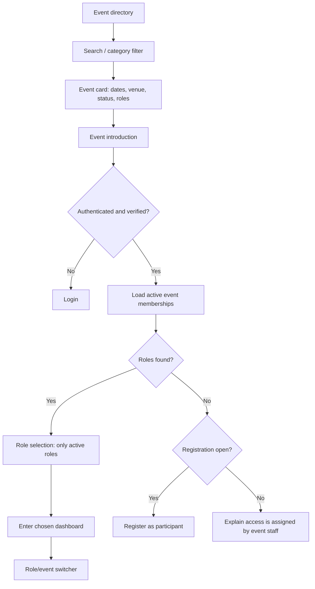
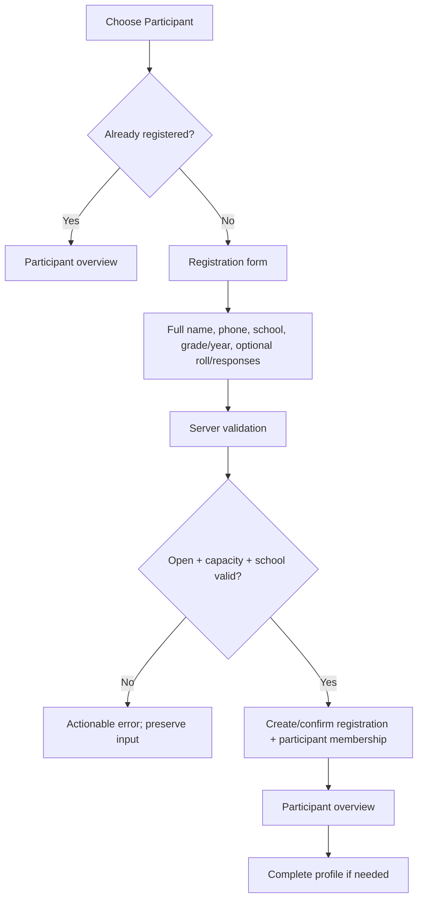
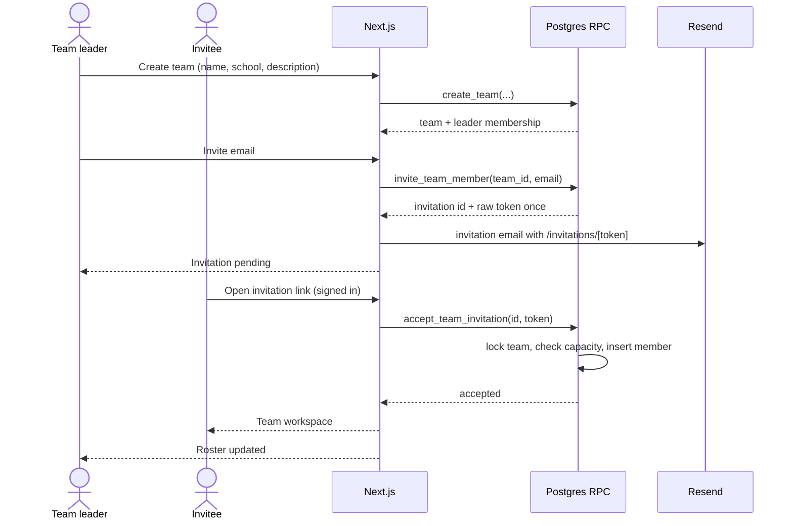
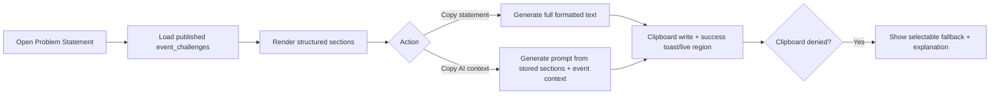
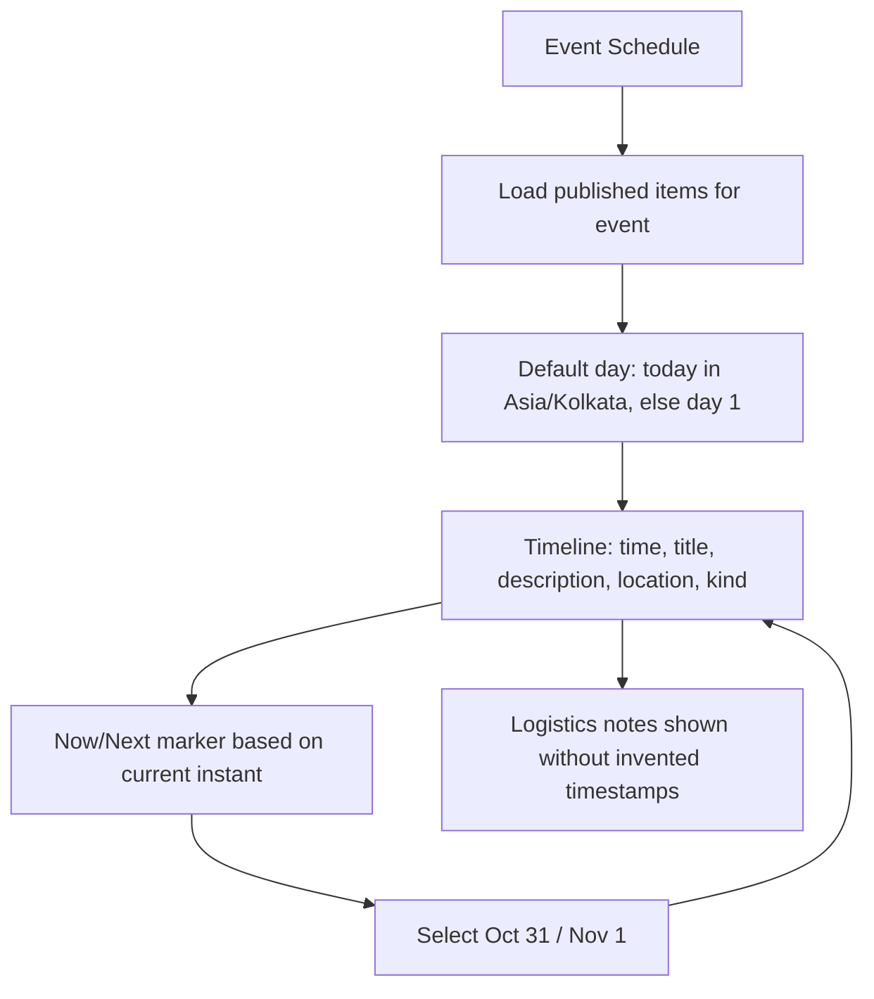
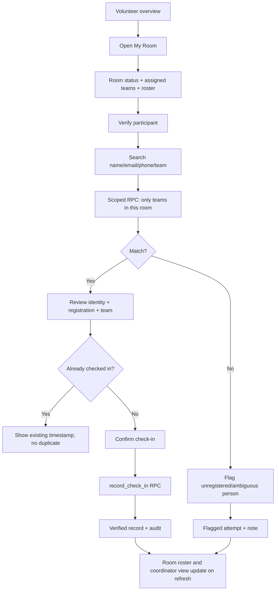
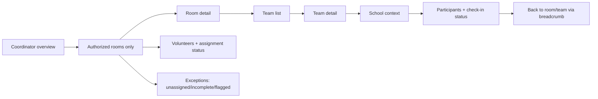
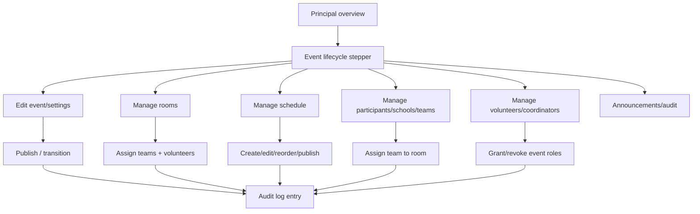
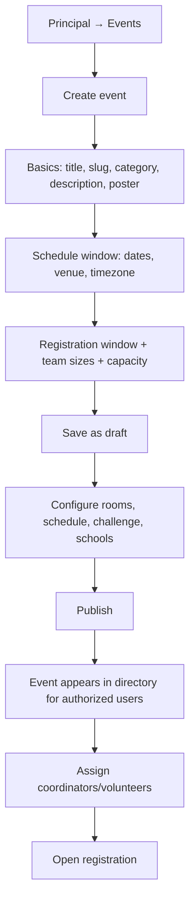
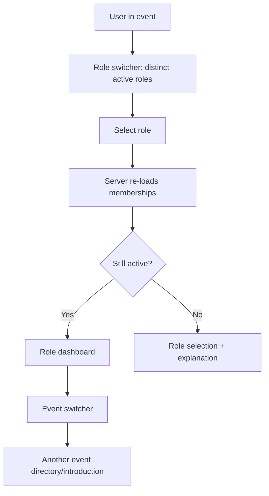

# Gatik Events — User Flows

**Status:** Design only. No flow has been implemented or tested.
**Source of truth for:** end-to-end journeys, decision points, and user-facing edge cases. Business rules live in [PRODUCT_SPEC.md](PRODUCT_SPEC.md); permissions in [RBAC_PERMISSION_MATRIX.md](RBAC_PERMISSION_MATRIX.md).
**Related:** [System architecture](SYSTEM_ARCHITECTURE.md) · [Design](DESIGN.md) · [Test plan](TEST_PLAN.md)

---

## 1. Account creation, verification, and login

```mermaid
flowchart TD
    A[Landing] --> B{Existing account?}
    B -- No --> C[Sign up: name, email, password]
    C --> D[Supabase creates auth user + profile trigger]
    D --> E[Verification email via Resend SMTP]
    E --> F[User opens verification link]
    F --> G[/auth/callback exchanges code]
    G --> H[Event directory]
    B -- Yes --> I[Log in]
    I --> J{Email verified?}
    J -- No --> K[Verify email screen + resend]
    J -- Yes --> H
    I --> L[Forgot password]
    L --> M[Reset email]
    M --> N[/auth/update-password]
    N --> H
    H --> O[Logout]
```

**Edge cases**

- Duplicate email: generic, safe message; offer sign-in/reset.
- Expired verification/reset link: explain and offer a new link.
- Wrong password: field-level error, no account enumeration.
- Unverified user: cannot enter directory/roles; can resend.
- Open redirect: `next` must be a relative path; external URLs rejected.

---

## 2. Event directory → event introduction → role selection



**Rules**

- Draft events are visible only to principals.
- Role cards are generated from memberships; no role is self-granted.
- A participant with incomplete registration is sent to onboarding before the participant dashboard.
- A staff member whose role was revoked sees the role selection page with a clear message, not a broken dashboard.

---

## 3. Participant registration



**Validation**

- One registration per user/event; duplicate returns a link to the existing registration.
- School must be in `event_schools`.
- Capacity check is transactional.
- Email is read-only from the account.
- Required fields are marked; errors are associated with fields and summarized.

---

## 4. Team creation, invitation, and acceptance



**Failure branches**

- Invitee not registered for the event: invitation blocked with a clear message.
- Invitee already on a team: blocked; show team name only if permitted? Prefer generic "already on a team for this event."
- Team full: blocked.
- Expired/revoked token: safe message; leader can resend.
- Concurrent acceptance of the last slot: one succeeds; the other receives a capacity message.
- Leader removes a member / leaves: leader must transfer leadership first or disband a one-person forming team (policy pending).
- Team name duplicate: case-insensitive conflict message with a suggested alternative.

---

## 5. Problem statement and copy actions



**Rules**

- Content comes from the database, not a hardcoded page or PDF.
- Missing sections are not invented; if the challenge is unpublished/incomplete, the UI shows an honest unavailable state.
- Copy content includes every stored section and the evaluation criteria.
- AI context is generated server-side from the same source; no stale duplicate.
- No HTML injection; content is plain text/structured sections.

---

## 6. Event schedule



**Rules**

- Times are stored with timezone and rendered in `Asia/Kolkata`.
- Point-in-time items show a single time; no fabricated end time.
- Approximate notes use `time_label` and a note style.
- The PDF is not embedded as the primary schedule.
- If the current date is outside the event, show the first day and a clear "event completed/upcoming" state.

---

## 7. Volunteer room and verification



**Rules**

- Search/navigation never crosses rooms.
- The volunteer confirms identity before recording; no one-tap accidental check-in.
- Unregistered/ambiguous people are flagged, never converted into verified participants.
- Duplicate verified check-ins are rejected.
- Room status updates are audited; a volunteer cannot rename rooms or change capacity.
- Offline check-in is not available; the UI explains connectivity requirements.

---

## 8. Coordinator drill-down



**Rules**

- `coordinator_assignments` determines rooms; null means all.
- Counts are real database aggregates.
- A coordinator cannot see rooms outside scope, even by guessing IDs.
- Drill-down preserves breadcrumb context and back behavior.
- No editing of check-ins or role assignments.

---

## 9. Principal event administration



**Rules**

- Lifecycle transitions validated; registration cannot open without dates/capacity/settings.
- Team-to-room capacity and volunteer/coordinator membership validated.
- Staff role assignment resolves an existing account by email; no invitation email required for role assignment in the MVP.
- Last active principal cannot be removed.
- Event creation grants creator principal membership; institution-level governance is an open question.
- Every sensitive change is audited and confirmed in the UI.

---

## 10. Principal creates a new event



**Rules**

- New event is a draft until published.
- Creator receives principal membership in the same transaction.
- Slug unique; changing a published slug requires redirects (future) or is blocked.
- The new event is independent: no Xplorer data leaks into it.
- Event templates are future work; the MVP duplicates configuration intentionally.

---

## 11. Role switching and revocation



- Switching does not modify membership or data.
- Revoked role access is denied on the next request/navigation.
- A multi-role user sees only the data appropriate to the current role; participant team data is not exposed through a coordinator route unless scope allows it.

---

## 12. Cross-flow error and empty states

| Situation | User experience |
|---|---|
| No events published | Directory empty state: "No events are open yet"; principals see a create action |
| No membership | Event intro explains staff access is assigned; participant registration CTA if open |
| Registration closed | Clear deadline and contact path; no disabled mystery button |
| Team not formed | Overview shows progress and invite action; operational eligibility explained |
| No rooms assigned | Volunteer sees "No room assigned yet"; coordinator/principal sees an exception |
| No search results | Explain scope ("Only participants in Room 3 are searchable") and offer flag action |
| Already checked in | Show time, volunteer, room; no duplicate action |
| Unregistered person | Flag record with note; explain that this does not create an account |
| Permission denied | Safe explanation + return to authorized area; no cross-event data |
| Network failure | Offline banner; retry action; preserve form input where safe |
| Challenge unpublished | Honest "Challenge not published yet" state; no placeholder claims |
| Schedule empty | Empty state with event contact; no invented activities |
